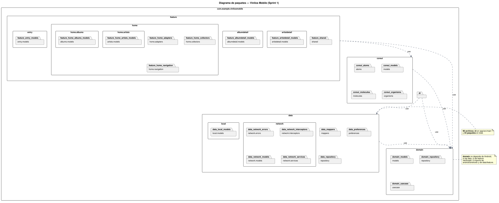
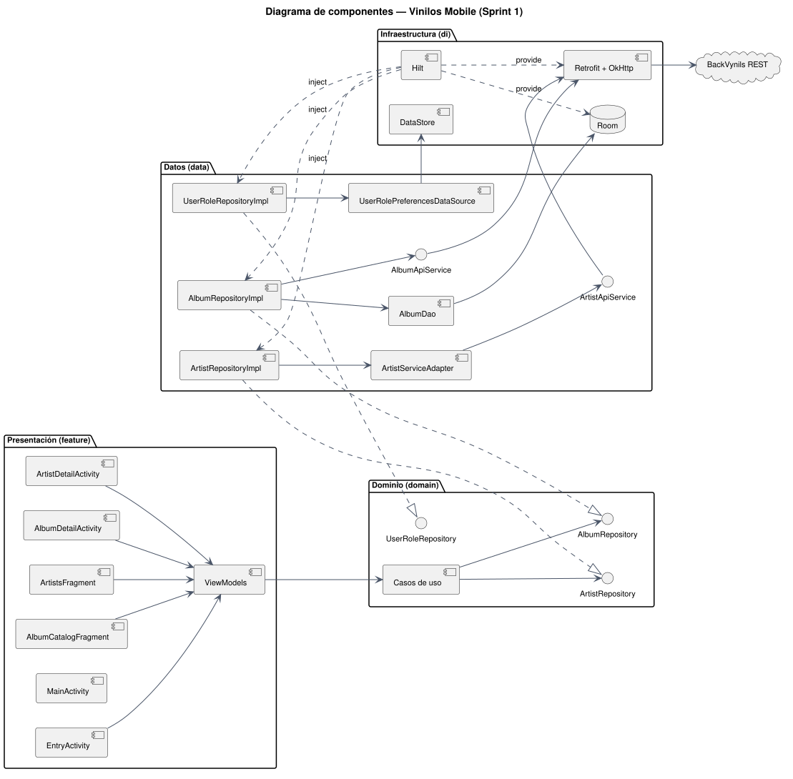
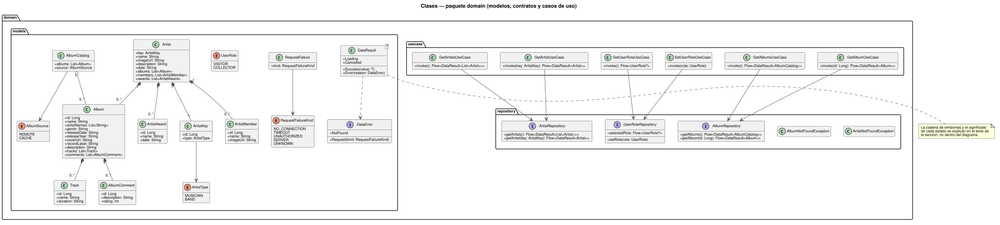
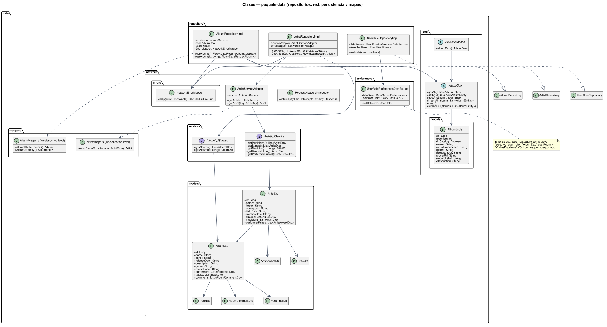
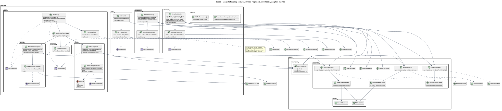

# Arquitectura de Vinilos Mobile — Sprint 1

Este documento describe el diseño estructural de la aplicación construida para HU01–HU04 en un único módulo Gradle `:app`, con Kotlin, Android Views/XML, Material, MVVM y una separación de responsabilidades inspirada en Clean Architecture. La organización interna se reparte en cuatro paquetes de código —`domain`, `data`, `feature` y `coreui`— más `di`, que conecta las piezas mediante Hilt.

El diseño se documenta con UML y se mantiene cerca del código. Cada diagrama tiene su fuente PlantUML en `docs/diagramas/*.puml`, versionada en el mismo repositorio que el SVG renderizado `docs/diagramas/*.svg`. Al cambiar una clase, un paquete o una interfaz se edita la fuente y se vuelve a renderizar, de modo que la figura y el código no se separan con el tiempo. Esta sección final explica el comando de regeneración.

Las figuras muestran estructura: paquetes, componentes, interfaces y clases. La explicación de cada regla de diseño vive en el texto que acompaña a la figura, nunca dentro de ella, para que el diagrama pueda leerse como UML y el razonamiento se encuentre donde corresponde.

## 1. Diagramas UML

| Diagrama | Archivo | Qué responde |
|---|---|---|
| Paquetes | `01-paquetes.svg` | ¿Cómo se organiza el código y qué paquete puede depender de cuál? |
| Componentes | `02-componentes.svg` | ¿Qué piezas ejecutables existen y qué interfaces conectan presentación, dominio y datos? |
| Clases — dominio | `03-clases-dominio.svg` | ¿Qué modelos, contratos de repositorio y casos de uso definen la regla de negocio? |
| Clases — datos | `04-clases-datos.svg` | ¿Qué implementaciones, servicios, DTO, DAO, entidades y mapeos satisfacen esos contratos? |
| Clases — presentación | `05-clases-presentacion.svg` | ¿Qué Activities, Fragments, ViewModels, Adapters, ViewHolders y Views componen la UI y cómo se conectan? |

Las cinco figuras siguen la notación UML 2 y usan los mismos nombres que el código, sin sufijos añadidos. En los diagramas de clases, la línea con triángulo hueco indica realización de interfaz, la flecha discontinua indica dependencia, el rombo relleno indica composición y el rombo hueco indica agregación. En el diagrama de componentes, cada interfaz aparece junto al componente que la provee o la requiere.

### 1.1. Diagrama de paquetes



El diagrama dibuja los 38 nodos de paquete del proyecto: los cuatro contenedores de capa (`coreui`, `domain`, `data`, `feature`) y los 34 paquetes que contienen archivos Kotlin. La regla que gobierna las flechas es de una sola dirección: la presentación conoce al dominio, el dominio no conoce a nadie.

- `feature` depende de `domain` y de `coreui`. Nunca importa `data` ni `di`: los ViewModels reciben casos de uso, no repositorios concretos.
- `data` depende de `domain`. Implementa sus contratos y traduce DTO y entidades a modelos de dominio; no conoce pantallas ni componentes visuales.
- `coreui` depende de `domain`. Los adapters y las vistas compartidas consumen modelos de dominio y modelos de presentación propios, sin acceder a la red ni a la base de datos.
- `di` depende de `data` y de `domain`. Es el único lugar donde se nombran las implementaciones concretas.
- `domain` no depende de Android (`android.*` ni `androidx.*`), ni de `data`, ni de `feature`, ni de `coreui`, ni de `di`.

| Origen | Puede depender de | No puede depender de |
|---|---|---|
| `feature` | `domain`, `coreui` | `data`, `di` |
| `domain` | Solo Kotlin y `kotlinx.coroutines` | `android`, `androidx`, `data`, `feature`, `coreui`, `di` |
| `data` | `domain` | `feature`, `coreui`, `di` |
| `coreui` | `domain` | `data`, `feature`, `di` |
| `di` | `data`, `domain` | `feature`, `coreui` |

La regla no es una intención: una búsqueda de imports sobre `app/src/main` no encuentra ninguna referencia de `domain` a `android`, `androidx`, `data` o `feature`, ni referencias de `feature` a `data` —al margen de los archivos `databinding` que genera el compilador— ni de `coreui` a `data` o `feature`. El paquete raíz solo aloja `VinilosApplication`, anotada con `@HiltAndroidApp`, que es el punto de entrada del grafo de dependencias.

### 1.2. Diagrama de componentes



El diagrama usa la notación UML de componentes con interfaces provistas y requeridas. Las tres interfaces de repositorio son el contrato entre capas:

- `AlbumRepository` y `ArtistRepository` son requeridas por los casos de uso de dominio y provistas por `AlbumRepositoryImpl` y `ArtistRepositoryImpl`. El caso de uso declara lo que necesita; la implementación decide si la respuesta viene de Retrofit, de Room o de una combinación de ambos.
- `UserRoleRepository` sigue el mismo esquema: la requieren `GetUserRoleUseCase` y `SetUserRoleUseCase`, y la provee `UserRoleRepositoryImpl`, que delega en `UserRolePreferencesDataSource` sobre DataStore.

Las interfaces de red son de otra naturaleza: `AlbumApiService` y `ArtistApiService` las provee Retrofit a partir de anotaciones sobre la interfaz, no una clase escrita a mano. `AlbumRepositoryImpl` consume `AlbumApiService`; `ArtistRepositoryImpl` consume `ArtistServiceAdapter`, que a su vez usa `ArtistApiService` para combinar músicos y bandas. Los componentes de infraestructura —Retrofit + OkHttp, Room y DataStore— quedan detrás de esas interfaces y solo los instancia Hilt en `di`, que aparece en la figura con las dependencias `«inject»` y `«provide»`.

### 1.3. Diagramas de clases

Las tres figuras siguientes cubren las clases de cada capa. Se separaron por paquete para que cada una quepa en una lectura y para que el cambio de una capa obligue a regenerar solo su figura.

#### Clases del paquete `domain`



Cubre los modelos (`Album`, `AlbumCatalog`, `Artist`, `ArtistKey`, `ArtistMember`, `ArtistAward`, `Track`, `AlbumComment`), las enumeraciones (`ArtistType`, `AlbumSource`, `UserRole`, `RequestFailureKind`), los tipos de resultado (`DataResult`, `DataError`, `RequestFailure`), los tres contratos de repositorio y los seis casos de uso. La relación clave es la composición: un `Album` contiene `Track` y `AlbumComment`; un `Artist` contiene `Album`, `ArtistMember` y `ArtistAward`, y se identifica con un `ArtistKey` que combina identificador y `ArtistType`. Cada caso de uso apunta a la interfaz de repositorio que necesita, y `DataResult` transporta `Success`, `Error`, `Loading` o `Cancelled` sin que el dominio importe una sola clase de Android.

#### Clases del paquete `data`



Cubre las implementaciones de repositorio, los servicios Retrofit, los DTO de red, `ArtistServiceAdapter`, el interceptor de cabeceras, `NetworkErrorMapper`, la capa local (`AlbumDao`, `VinilosDatabase`, `AlbumEntity`), las funciones de mapeo y `UserRolePreferencesDataSource`. La relación clave es la realización: `AlbumRepositoryImpl`, `ArtistRepositoryImpl` y `UserRoleRepositoryImpl` implementan las interfaces declaradas en `domain.repository`, y cada implementación elige sus colaboradores —`AlbumApiService` más `AlbumDao` para álbumes, `ArtistServiceAdapter` para artistas, DataStore para el rol—. Los DTO y las entidades nunca cruzan esa frontera: `AlbumMappers` y `ArtistMappers` los convierten a modelos de dominio antes de emitir.

#### Clases de presentación: `feature` y `coreui`



Cubre las pantallas del sprint en `feature` —`EntryActivity`, `MainActivity`, `AlbumCatalogFragment`, `ArtistsFragment`, `AlbumDetailActivity`, `ArtistDetailActivity`, `CollectorsFragment`—, sus ViewModels, los estados sellados de UI, los adapters y las vistas compartidas de `coreui`. El flujo que repite cada pantalla es `Activity/Fragment → ViewModel → LiveData<UiState> → observe`: la vista delega la intención en el ViewModel, el ViewModel invoca un caso de uso y convierte sus emisiones en un estado sellado observable, y la vista lo recoge con `observe` y el ciclo de vida correspondiente (`viewLifecycleOwner` en Fragments, la propia Activity en Activities). Cada `*UiState` es una interfaz sellada con las variantes que necesita su pantalla —carga, contenido, vacío o no encontrado, error y cancelación—, y el ViewModel expone el `LiveData` de solo lectura mientras conserva el `MutableLiveData` privado. La otra relación estructural es la de las listas: `Adapter → ViewHolder → View`. `AlbumCardAdapter` crea `AlbumCardViewHolder`, que enlaza datos con `SquareAlbumCover` y `ArtistAvatarView`; `ArtistRowAdapter` y `DetailRowAdapter` hacen lo mismo con sus propios holders. `CollectorsFragment` aparece como marcador sin ViewModel ni adapter, porque su funcionalidad pertenece al Sprint 2.

### 1.4. Correspondencia entre el diseño y el código

Cada paquete dibujado corresponde a una carpeta real bajo `app/src/main/java/com/example/vinilosmobile/`. Los contenedores `coreui`, `domain`, `data` y `feature` no tienen archivos propios y agrupan a los paquetes hijos; `di` sí contiene las clases de Hilt.

| Paquete | Carpeta real | Contenido |
|---|---|---|
| `com.example.vinilosmobile` | `.` | `VinilosApplication` |
| `coreui.atoms` | `coreui/atoms/` | `ArtistAvatarView`, `SquareAlbumCover` |
| `coreui.models` | `coreui/models/` | modelos de presentación y su mapper |
| `coreui.molecules` | `coreui/molecules/` | adapters, holders y vistas compuestas |
| `coreui.organisms` | `coreui/organisms/` | `ContentStateView` |
| `domain.models` | `domain/models/` | modelos, enumeraciones y tipos de resultado |
| `domain.repository` | `domain/repository/` | contratos de repositorio y excepciones |
| `domain.usecase` | `domain/usecase/` | los seis casos de uso |
| `data.local` | `data/local/` | `AlbumDao`, `VinilosDatabase` |
| `data.local.models` | `data/local/models/` | `AlbumEntity` |
| `data.mappers` | `data/mappers/` | `AlbumMappers`, `ArtistMappers` |
| `data.network` | `data/network/` | `ArtistServiceAdapter` |
| `data.network.errors` | `data/network/errors/` | `NetworkErrorMapper` |
| `data.network.interceptors` | `data/network/interceptors/` | `RequestHeadersInterceptor` |
| `data.network.models` | `data/network/models/` | DTO de BackVynils |
| `data.network.services` | `data/network/services/` | `AlbumApiService`, `ArtistApiService` |
| `data.preferences` | `data/preferences/` | `UserRolePreferencesDataSource` |
| `data.repository` | `data/repository/` | las tres implementaciones |
| `di` | `di/` | módulos de Hilt |
| `feature.entry` | `feature/entry/` | `EntryActivity`, `EntryViewModel` |
| `feature.entry.models` | `feature/entry/models/` | `EntryUiState` |
| `feature.home` | `feature/home/` | `MainActivity`, `HomeViewModel` |
| `feature.home.adapters` | `feature/home/adapters/` | `HomeSectionPagerAdapter` |
| `feature.home.albums` | `feature/home/albums/` | `AlbumCatalogFragment`, `AlbumCatalogViewModel` |
| `feature.home.albums.models` | `feature/home/albums/models/` | `AlbumCatalogUiState` |
| `feature.home.artists` | `feature/home/artists/` | `ArtistsFragment`, `ArtistCatalogViewModel` |
| `feature.home.artists.models` | `feature/home/artists/models/` | `ArtistCatalogUiState` |
| `feature.home.collectors` | `feature/home/collectors/` | `CollectorsFragment` |
| `feature.home.navigation` | `feature/home/navigation/` | `AlbumNavigator`, `ArtistNavigator` |
| `feature.albumdetail` | `feature/albumdetail/` | `AlbumDetailActivity`, `AlbumDetailViewModel` |
| `feature.albumdetail.models` | `feature/albumdetail/models/` | `AlbumDetailUiState` |
| `feature.artistdetail` | `feature/artistdetail/` | `ArtistDetailActivity`, `ArtistDetailViewModel` |
| `feature.artistdetail.models` | `feature/artistdetail/models/` | `ArtistDetailUiState` |
| `feature.shared` | `feature/shared/` | `DateTextFormatter`, `RequestFailureMessage` |

Cada clase dibujada existe en el repositorio y cada archivo Kotlin de `main` pertenece a uno de estos paquetes, de modo que la figura y el árbol de fuentes se recorren en el mismo orden.

## 2. Navegación

Las tres secciones de Home se cambian con menú o deslizamiento. Los detalles viven en Activities propias y reciben el identificador, no un DTO completo. El rol persistido es la fuente de verdad: el FAB de álbum en Home y el de track en detalle solo aparecen para Coleccionista. Sus acciones son avisos de «próximamente» en este sprint.

Las rutas son las siguientes:

- Inicio → `EntryActivity`: sin rol guardado ofrece Visitante o Coleccionista; con rol guardado entra directo a `MainActivity`.
- `EntryActivity` → `MainActivity` tras guardar el rol en DataStore.
- `MainActivity` → `AlbumCatalogFragment`, `ArtistsFragment` y `CollectorsFragment` mediante `ViewPager2` y menú inferior.
- `AlbumCatalogFragment` → `AlbumDetailActivity` con el ID del álbum.
- `ArtistsFragment` → `ArtistDetailActivity` con `ArtistKey`.
- `MainActivity` → `EntryActivity` para cambiar el rol.

## 3. Flujo de artistas y conexión

La lista pide músicos y bandas en paralelo. El Repository emite la lista combinada cuando ambos endpoints responden; no muestra una lista parcial con solo músicos o bandas. El filtro Todos/Músicos/Bandas opera sobre la lista recibida, sin nuevas solicitudes. Los detalles usan el mismo flujo `Flow → collect → MutableLiveData → observe` y se consultan por tipo e ID; una consulta auxiliar a `/performerprizes` completa el nombre de premios cuando el backend no lo incluye. Si esa consulta auxiliar falla, el detalle principal sigue visible. **No se implementó modo offline de artistas**: sin red aparece estado de error y opción de reintento.

El recorrido de la pantalla es:

1. `ArtistsFragment` observa `state` con `viewLifecycleOwner` y dispara `reload()`.
2. `ArtistCatalogViewModel` invoca `GetArtistsUseCase`, que devuelve un `Flow<DataResult<List<Artist>>>`.
3. `ArtistRepositoryImpl` emite `Loading`; el caso de uso lo propaga y el ViewModel actualiza su `MutableLiveData`, que el observer pinta como carga.
4. `ArtistServiceAdapter` consulta en paralelo `getMusicians()` y `getBands()` contra BackVynils.
5. Si ambas respuestas llegan, el adapter convierte los DTO a `Artist`, combina y ordena, y el Repository emite `Success`. El ViewModel recoge con `collect` y publica `Content` o `Empty`.
6. Al tocar una fila, `ArtistsFragment` abre `ArtistDetailActivity` con un `ArtistKey`; el detalle solicita el artista y, cuando existe, sus premios.
7. Si una consulta falla o no hay red, el Repository emite `Error(DataError.Request)`; el observer muestra el error y la opción de reintentar.
8. Una solicitud interrumpida de forma independiente emite `Cancelled`, que también permite reintentar sin cerrar la pantalla.

## 4. Room y funcionamiento sin red

Room usa `VinilosDatabase` versión 1, esquema exportado a `app/schemas/`, y una tabla `albums`. `AlbumEntity` guarda `id`, posición del catálogo, marca `inCatalog`, nombre, artistas como JSON, género, año, portada, sello y descripción. `AlbumDao.replaceAll` reemplaza el catálogo en una transacción; `upsert` actualiza un detalle sin añadirlo al catálogo si no estaba allí.

El patrón de lectura es «caché primero, red después»:

1. Al iniciar una consulta, el Repository lee Room y emite de inmediato `Success` con los datos guardados, si existen, marcados con `AlbumCatalog.source = CACHE` para avisar al usuario que ve datos guardados.
2. Después pide `GET /albums` o `GET /albums/{id}`.
3. Convierte el DTO a dominio, actualiza Room y emite la versión de red con `source = REMOTE`.
4. Si la red falla, la emisión guardada permanece visible; sin copia local se emite `Error` y la pantalla ofrece reintentar.
5. Una cancelación independiente emite `Cancelled`: se conserva el contenido en caché o se ofrece reintentar.

Un 404 de detalle termina en `NotFound` aunque se haya emitido antes una copia local.

El detalle de álbum usa el mismo flujo y puede emitir el detalle guardado antes del detalle nuevo. La caché de álbumes es **parcial**: la entidad actual no guarda tracks, comentarios ni fecha completa. Un detalle sin red puede mostrar solo los campos persistidos. DataStore es separado de Room y guarda únicamente `selected_user_role` (`visitor` o `collector`), para conservar la elección entre aperturas. Su `Flow` se recoge en los ViewModels de Entry, Home y detalle; Entry usa `first()` para decidir la navegación inicial y Home observa cambios posteriores.

## 5. Tecnologías y decisiones

| Tecnología o decisión | Uso y motivo |
|---|---|
| Un módulo `:app`; paquetes `feature`, `domain`, `data`, `di`, `coreui` | Mantiene límites claros sin el coste de módulos Gradle adicionales para cuatro HU. |
| Kotlin + Android Views/XML + Material | Implementa los diseños en el stack acordado y conserva soporte desde API 21. |
| `coreui/atoms`, `molecules`, `organisms`, `models` | Reúne vistas reutilizables; «atomic design» guía la organización, no añade un módulo ni sustituye XML. |
| Repository y casos de uso con `Flow<DataResult<T>>` | Transmiten carga, éxitos, errores tipados y cancelación independiente; permiten emitir primero Room y después red sin bloquear la pantalla. |
| ViewModel + LiveData + estados sellados | `collect` transforma emisiones de dominio en estados observables con el ciclo de vida de la pantalla. |
| Hilt + KSP | Provee servicios, repositorios, Room, DataStore y ViewModels sin construirlos en Activities. |
| Retrofit + Gson + OkHttp | Un cliente y una URL configurables para BackVynils; errores y cabeceras centralizados. |
| Room | Copia local del catálogo y detalles básicos de álbumes para fallos de conexión. |
| DataStore Preferences | Persiste el rol sin usar la base relacional para una sola preferencia. |
| ViewPager2 + RecyclerView + Glide | Navegación entre secciones, listas eficientes y carga de imágenes. |

Las versiones exactas están en [`gradle/libs.versions.toml`](../gradle/libs.versions.toml). La URL base se puede configurar con `-PvinilosApiBaseUrl=.../`; en el emulador Debug, `10.0.2.2` apunta al Docker local. La suite cubre 46 pruebas unitarias con JUnit y MockK (casos de uso, repositorios, adaptación y mapeo de DTO, interceptor, errores y DataStore) y 15 escenarios Espresso; Robolectric y Espresso verifican `AlbumDao` con Room real en memoria. El código de `main` se reparte en 90 archivos Kotlin y 34 paquetes. Véase [pruebas Sprint 1](PRUEBAS_SPRINT1.md).

## Regenerar los diagramas

Las fuentes PlantUML y los SVG están versionados juntos. Tras modificar una fuente, se regeneran todas las figuras con:

```bash
cd docs/diagramas && plantuml -tsvg *.puml
```
