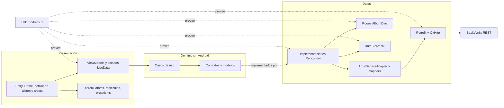
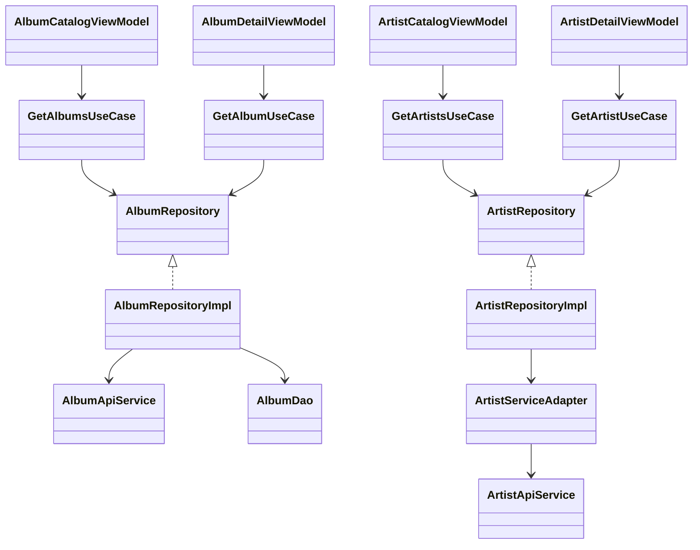
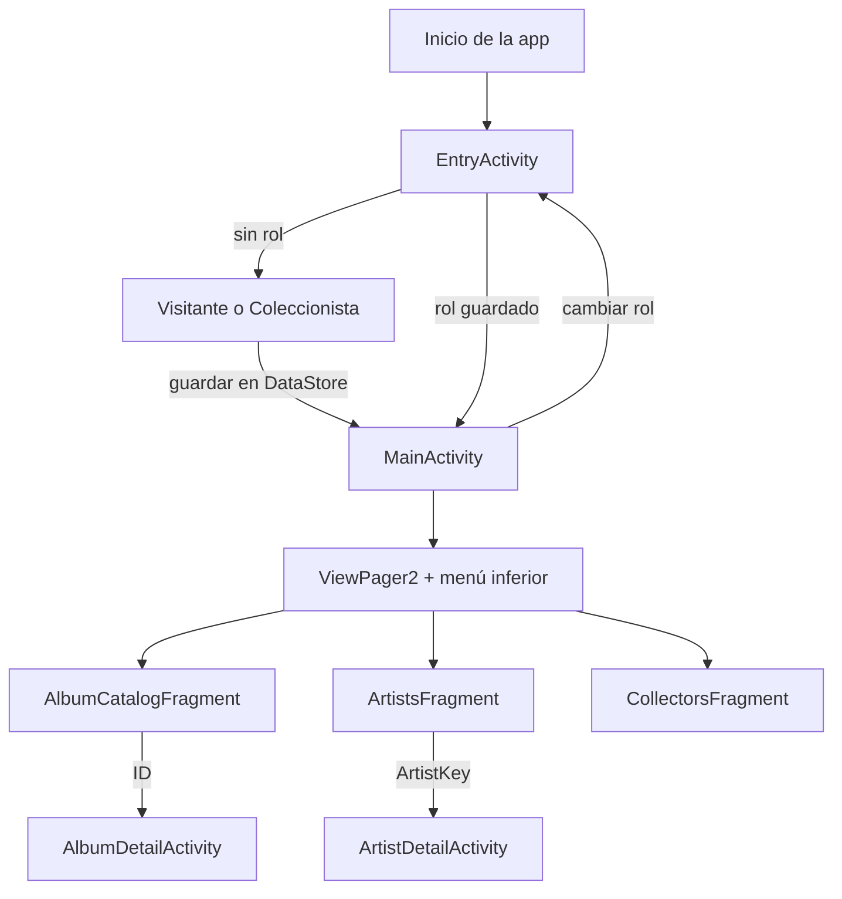
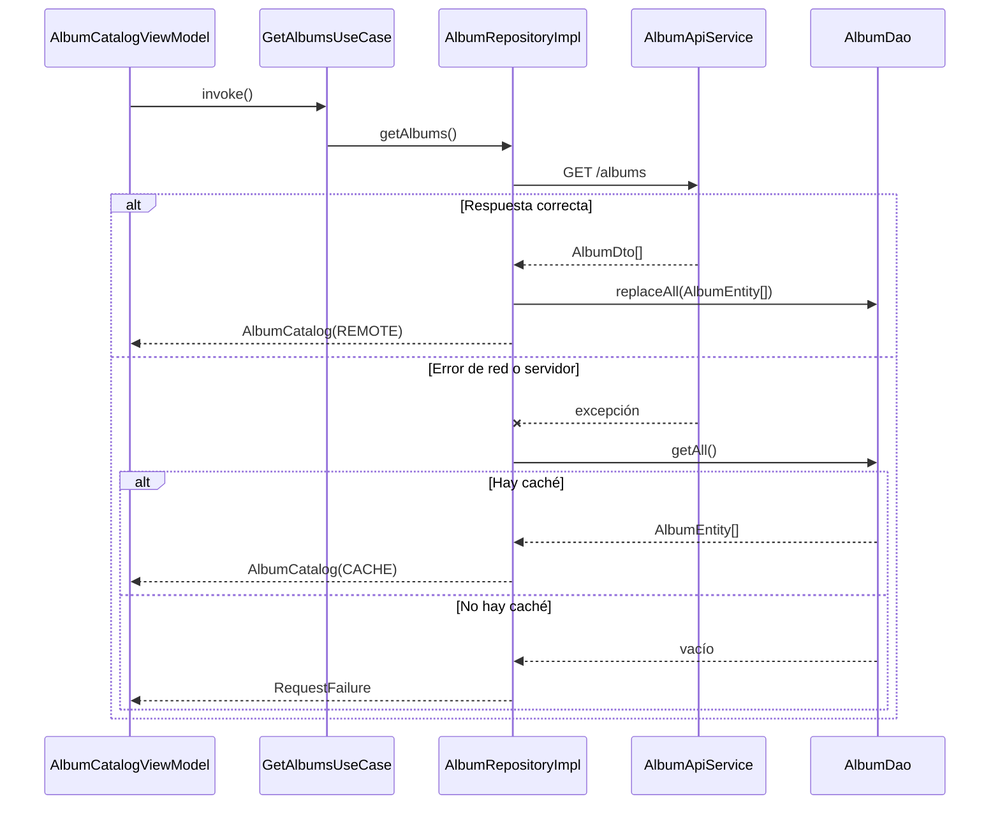

# Arquitectura de Vinilos Mobile — Sprint 1

Implementación de HU01–HU04 en un único módulo Gradle `:app`. Se usan Kotlin, Android Views/XML, Material, MVVM y una separación de responsabilidades inspirada en Clean Architecture. `domain/` declara modelos, contratos de repositorio y casos de uso; `data/` implementa los contratos; `feature/` contiene las pantallas; `coreui/` reúne vistas y adapters compartidos. Hilt construye las dependencias en `di/`.

## Componentes y dependencias



Una pantalla envía eventos al ViewModel y observa `LiveData`. El ViewModel mantiene `MutableLiveData` privado y publica estados sellados (`Loading`, `Content`, `Empty`, `Error` y, en los detalles, `NotFound`). Los casos de uso invocan contratos de dominio; los repositorios deciden la fuente de datos. DTO y entidades Room no llegan a la UI. El `NetworkErrorMapper` transforma fallos técnicos en categorías para mensajes legibles. Los interceptores añaden cabeceras comunes y registran solo datos básicos en Debug; Release desactiva ese registro.

## Relaciones principales



`ArtistKey` combina ID y tipo (`MUSICIAN` o `BAND`) para elegir el endpoint correcto. `GetUserRoleUseCase` y `SetUserRoleUseCase` acceden al contrato de rol; DataStore queda encapsulado en `UserRolePreferencesDataSource`.

## Navegación



Las tres secciones de Home se cambian con menú o deslizamiento. Los detalles viven en Activities propias y reciben el identificador, no un DTO completo. El rol persistido es la fuente de verdad: el FAB de álbum en Home y el de track en detalle solo aparecen para Coleccionista. Sus acciones son avisos de “próximamente” en este sprint.

## Flujo de artistas y conexión

```mermaid
sequenceDiagram
  actor Usuario
  participant Vista as ArtistsFragment
  participant VM as ArtistCatalogViewModel
  participant UC as GetArtistsUseCase
  participant Repo as ArtistRepositoryImpl
  participant Adapter as ArtistServiceAdapter
  participant API as ArtistApiService
  participant Server as BackVynils
  participant Detail as ArtistDetailActivity
  Usuario->>Vista: Abre Artistas
  Vista->>VM: observa state / reload()
  VM->>UC: invoke()
  UC->>Repo: getArtists()
  Repo->>Adapter: getArtists()
  par Consultas concurrentes
    Adapter->>API: getMusicians()
    API->>Server: GET /musicians
    Server-->>API: músicos JSON
  and
    Adapter->>API: getBands()
    API->>Server: GET /bands
    Server-->>API: bandas JSON
  end
  alt Ambas respuestas correctas
    Adapter->>Adapter: DTO a Artist, combinar y ordenar
    Adapter-->>Repo: List<Artist>
    Repo-->>UC: List<Artist>
    UC-->>VM: List<Artist>
    VM-->>Vista: Content o Empty por LiveData
    Vista-->>Usuario: Lista y filtros locales
    opt Selecciona un artista
      Usuario->>Vista: Toca fila
      Vista->>Detail: abre con ArtistKey
      Note over Detail,Server: Solicita /musicians/{id} o /bands/{id}; consulta premios si existen
    end
  else Falla una consulta o no hay red
    Server--xAPI: error
    Repo-->>VM: RequestFailure
    VM-->>Vista: Error + Reintentar
    Note over Repo,Server: Artistas no tienen caché Room en Sprint 1
  end
```

La lista pide músicos y bandas en paralelo. El filtro Todos/Músicos/Bandas opera sobre la lista recibida, sin nuevas solicitudes. Los detalles se consultan por tipo e ID; una consulta auxiliar a `/performerprizes` completa el nombre de premios cuando el backend no lo incluye. Si esa consulta auxiliar falla, el detalle principal sigue visible. **No se implementó modo offline de artistas**: sin red aparece estado de error y opción de reintento.

## Room y funcionamiento sin red

Room usa `VinilosDatabase` versión 1, esquema exportado a `app/schemas/`, y una tabla `albums`. `AlbumEntity` guarda `id`, posición del catálogo, marca `inCatalog`, nombre, artistas como JSON, género, año, portada, sello y descripción. `AlbumDao.replaceAll` reemplaza el catálogo en una transacción; `upsert` actualiza un detalle sin añadirlo al catálogo si no estaba allí. El repositorio intenta primero `GET /albums` o `GET /albums/{id}`, convierte DTO a dominio y escribe Room. Ante una falla de red o servidor lee Room. `AlbumCatalog.source = CACHE` permite avisar al usuario que ve datos guardados. Un 404 de detalle se trata como inexistente y no muestra una copia vieja.



La caché de álbumes es **parcial**: la entidad actual no guarda tracks, comentarios ni fecha completa. Un detalle sin red puede mostrar solo los campos persistidos. DataStore es separado de Room y guarda únicamente `selected_user_role` (`visitor` o `collector`), para conservar la elección entre aperturas.

## Tecnologías y decisiones

| Tecnología o decisión | Uso y motivo |
|---|---|
| Un módulo `:app`; paquetes `feature`, `domain`, `data`, `di`, `coreui` | Mantiene límites claros sin el coste de módulos Gradle adicionales para cuatro HU. |
| Kotlin + Android Views/XML + Material | Implementa los diseños en el stack acordado y conserva soporte desde API 21. |
| `coreui/atoms`, `molecules`, `organisms`, `models` | Reúne vistas reutilizables; “atomic design” guía la organización, no añade un módulo ni sustituye XML. |
| ViewModel + LiveData + estados sellados | Conserva estado de pantalla en cambios de configuración y limita la lógica de UI al ViewModel. |
| Hilt + KSP | Provee servicios, repositorios, Room, DataStore y ViewModels sin construirlos en Activities. |
| Retrofit + Gson + OkHttp | Un cliente y una URL configurables para BackVynils; errores y cabeceras centralizados. |
| Room | Copia local del catálogo y detalles básicos de álbumes para fallos de conexión. |
| DataStore Preferences | Persiste el rol sin usar la base relacional para una sola preferencia. |
| ViewPager2 + RecyclerView + Glide | Navegación entre secciones, listas eficientes y carga de imágenes. |

Las versiones exactas están en [`gradle/libs.versions.toml`](../gradle/libs.versions.toml). La URL base se puede configurar con `-PvinilosApiBaseUrl=.../`; en el emulador Debug, `10.0.2.2` apunta al Docker local. Las pruebas unitarias con JUnit y MockK cubren casos de uso, repositorios, adaptación y mapeo de DTO, interceptor, errores y DataStore; Robolectric verifica `AlbumDao` con Room real en memoria. Espresso también usa Room en memoria y recorre las cuatro HU con respuestas HTTP controladas. Véase [pruebas Sprint 1](PRUEBAS_SPRINT1.md).
