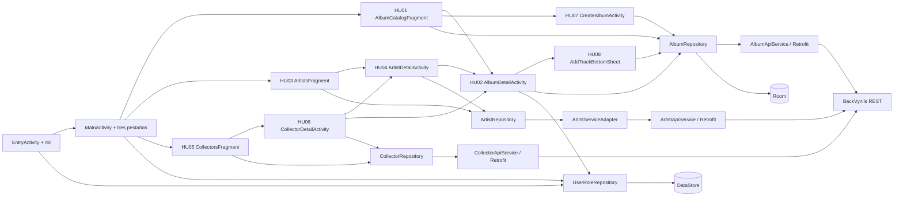
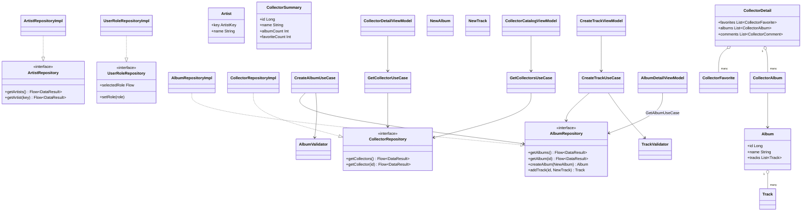
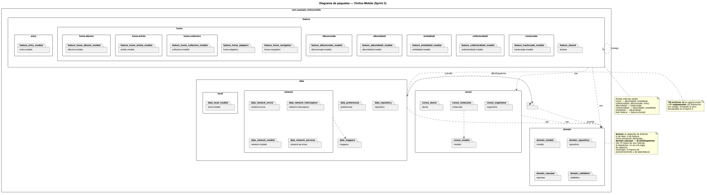
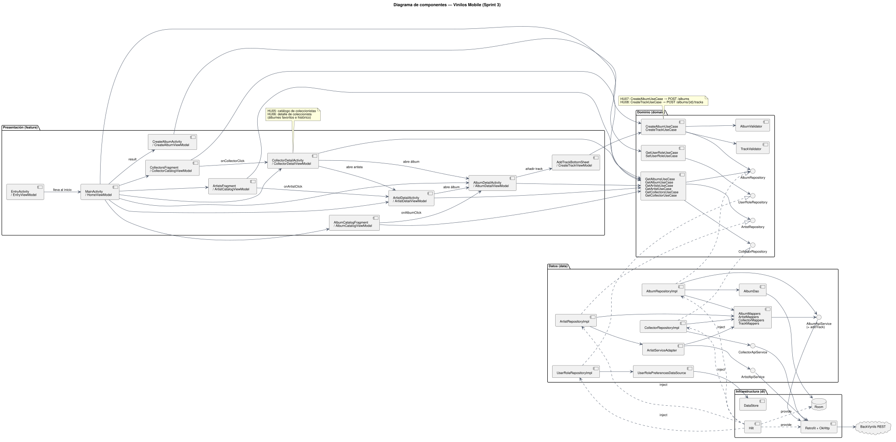

# Arquitectura del MVP — Sprint 3

Esta versión cubre HU01–HU08 en un único módulo Gradle `:app`. El código usa Android Views/XML, MVVM, casos de uso, contratos Repository, Hilt, Retrofit/OkHttp, Room y DataStore. Complementa el [diseño detallado de Sprint 1](ARQUITECTURA_SPRINT1.md), que sigue describiendo HU01–HU04.

## Paquetes y reglas de dependencia

```mermaid
flowchart TB
    subgraph feature[feature]
      entry[entry]
      home[home: albums, artists, collectors]
      details[albumdetail, artistdetail, collectordetail]
      forms[albumcreate, trackcreate]
    end
    subgraph domain[domain]
      models[models]
      usecases[usecase]
      contracts[repository]
      validation[validation]
    end
    subgraph data[data]
      repos[repository]
      mapper[mappers]
      network[network: services, DTO, errors]
      local[local: Room]
      prefs[preferences: DataStore]
    end
    ui[coreui: atoms, molecules, organisms, models]
    di[di: módulos Hilt]
    feature --> domain
    feature --> ui
    feature -->|navegación entre pantallas| feature
    ui --> domain
    repos --> contracts
    repos --> mapper
    repos --> network
    repos --> local
    repos --> prefs
    mapper --> models
    usecases --> contracts
    usecases --> validation
    di --> data
    di --> domain
    usecases -.->|@IoDispatcher| di
    repos -.->|@IoDispatcher| di
    network --> mapper
    ui -->|UiModels| models
```

`domain` no importa Android, Retrofit, OkHttp, Room ni las pantallas. Las Activities y Fragments observan `LiveData` del ViewModel y envían eventos. Los ViewModels reciben casos de uso, no servicios HTTP ni DAOs. Los DTO y entidades no llegan a Views. Hilt conecta los contratos con sus implementaciones.

Hay dos excepciones reales que la versión anterior del diagrama no dibujaba y que conviene declarar en lugar de ocultar. Primera: **`domain.usecase` y `data.repository` importan `di.@IoDispatcher`** para inyectar el despachador de E/S; la regla «domain no depende de nada» se cumple para Android, `data` y `feature`, pero no para ese calificador de Hilt. Segunda: **`feature` depende de `feature`** por la navegación —`home` abre los tres detalles y el formulario, `albumdetail` abre la hoja de track, y `collectordetail` abre el detalle de álbum y el de artista—. Ambas aristas están verificadas con los `import` del código y aparecen en el [diagrama de paquetes](diagramas/01-paquetes.puml) y en el [de componentes](diagramas/02-componentes.puml).

## Componentes e historias



Cada flecha desde presentación hacia un repositorio pasa en el código por su ViewModel y un caso de uso. La figura comprime esos pasos para que quepan las ocho historias. `ArtistServiceAdapter` combina `/musicians`, `/bands` y premios; el `CollectorRepositoryImpl` coordina `/collectors/{id}` y `/collectors/{id}/albums`. `AlbumRepositoryImpl` usa Room como caché para HU01/HU02 y la red para HU07/HU08.

## Clases principales



Los casos de consulta restantes (`GetAlbumsUseCase`, `GetAlbumUseCase`, `GetArtistsUseCase`, `GetArtistUseCase`, `GetUserRoleUseCase` y `SetUserRoleUseCase`) conservan la misma estructura; están descritos en la arquitectura anterior. Los estados `DataResult` representan carga, éxito, error tipado y cancelación. Los `UiState` de cada pantalla son excluyentes y pertenecen a `feature/*/models`.

## Diagramas de paquetes y componentes

Los dos diagramas se regeneraron el 26 de noviembre de 2026 a partir del árbol real de archivos: **136 archivos `.kt`** y **41 subpaquetes** bajo `app/src/main/java/com/example/vinilosmobile/` (42 directorios contando la raíz, con `VinilosApplication`).

| Diagrama | Fuente | Imagen |
|---|---|---|
| Paquetes | [`diagramas/01-paquetes.puml`](diagramas/01-paquetes.puml) | [`01-paquetes.svg`](diagramas/01-paquetes.svg) |
| Componentes | [`diagramas/02-componentes.puml`](diagramas/02-componentes.puml) | [`02-componentes.svg`](diagramas/02-componentes.svg) |





Los paquetes que faltaban en la versión anterior y ya están dibujados son `feature.collectordetail`, `feature.collectordetail.models`, `feature.trackcreate`, `feature.trackcreate.models` y `feature.home.collectors.models`. Los componentes de HU05, HU06 y HU08 —`CollectorsFragment`, `CollectorCatalogViewModel`, `CollectorDetailActivity`, `CollectorDetailViewModel`, `AddTrackBottomSheet`, `CreateTrackViewModel`, `CollectorRepository` con su implementación, `CollectorApiService`, `TrackValidator` y el método `addTrack` de `AlbumApiService`— también estaban ausentes y ahora aparecen con sus dependencias.

## Decisiones de implementación

| Decisión | Razón y efecto |
|---|---|
| Room solo para álbumes | HU01 emite copia guardada antes de refrescar; listados de artistas y coleccionistas dependen de red. |
| Dos consultas para HU06 | `GET /collectors/{id}` no trae el objeto `album` de cada relación; `GET /collectors/{id}/albums` sí. Si esta segunda falla, se muestra el perfil con un aviso específico en la sección de álbumes. |
| Validación de HU08 en `domain` | Rechaza nombre vacío y duración distinta de `mm:ss` antes del POST; el error de cada campo se comunica en español. |
| Resultado de HU08 con Fragment Result API | El detalle recibe el track creado, actualiza la lista y el contador sin reiniciar, y conserva el dato ante una respuesta GET tardía. |
| Trabajo de red en dispatcher IO | Retrofit, Room y repositorios se ejecutan fuera del hilo de interfaz. Los ViewModels cancelan solicitudes al destruirse. |
| Componentes compartidos | `ArtistRowAdapter`, `AlbumCardAdapter`, `DetailRowAdapter`, `SectionHeaderView`, `ContentStateView` y `ArtistAvatarView` mantienen el lenguaje visual entre historias. |

La arquitectura debe contrastarse con la versión final integrada en `develop` y `main` antes del release. Los diagramas describen el código de esta rama de funcionalidad.
