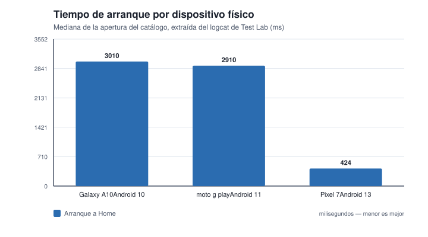
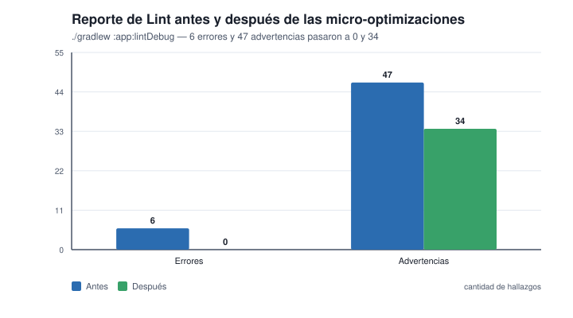
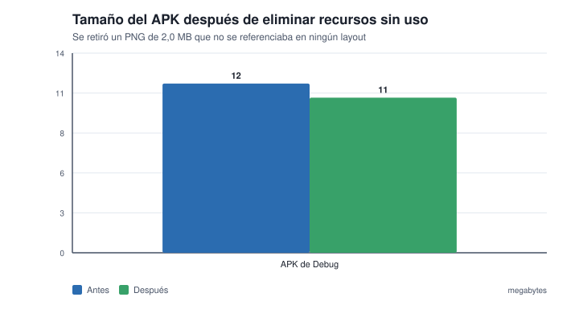
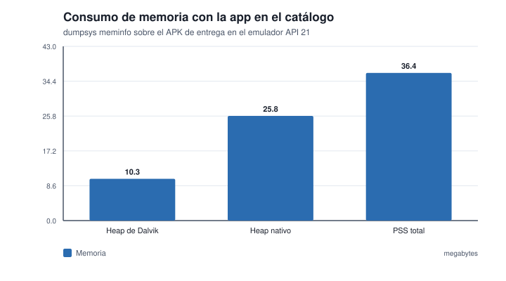

# Desempeño del Sprint 2 — micro-optimizaciones y perfilamiento

Documento de apoyo del Sprint 2. Resume las micro-optimizaciones aplicadas, las buenas prácticas de hilos y memoria que ya están en el código, y las mediciones de perfilamiento obtenidas hasta ahora.

## 1. Micro-optimizaciones aplicadas

La línea base fue el reporte de Lint del proyecto: **6 errores y 47 advertencias**, con el build de `lintDebug` fallando por los errores. Cada hallazgo se corrigió o se justificó.

| Hallazgo de Lint | Qué se cambió | Efecto |
|---|---|---|
| `NewApi` (1 error): `android:windowLightStatusBar` requiere API 23 y el mínimo es 21 | Se quitó del tema base. El tema es `Theme.Material3.Dark.NoActionBar`, donde el valor por defecto ya es `false` | Elimina un riesgo real de incompatibilidad en Android 5.0, que es el mínimo soportado |
| `UseAppTint` (5 errores): `android:tint` en `ImageView` | `app:tint` en `activity_entry`, `activity_main`, `vinilos_item_artist` y `vinilos_view_role_option`, declarando `xmlns:app` donde faltaba | Tinte correcto con `AppCompatImageView`; el atributo de plataforma se ignora en versiones antiguas |
| `Overdraw` (7 advertencias): el layout raíz pintaba `@color/vinilos_background` | Se quitó el fondo de los siete layouts raíz. El tema ya pinta `android:colorBackground` con ese mismo color | Una capa de pintado menos por pantalla, sin cambio visual |
| `DisableBaselineAlignment` (2) | `android:baselineAligned="false"` en dos `LinearLayout` del detalle de álbum y de artista | Evita el cálculo de alineación de línea base en cada medida |
| `ContentDescription` (1) | `android:contentDescription` en la carátula del detalle | Accesibilidad: el lector de pantalla anuncia la imagen |
| `ScrollViewSize` (1) | El hijo del `ScrollView` pasa de `match_parent` a `wrap_content` | Medida correcta del contenido desplazable |
| `UnusedResources` (5) | Se eliminó `vinilotornamesa.png` (2,0 MB), que no se referenciaba en ningún layout ni en código | Menos recursos empaquetados |

### Resultado

| Métrica | Antes | Después |
|---|---:|---:|
| Errores de Lint | **6** | **0** |
| Advertencias de Lint | **47** | **34** |
| `lintDebug` | Fallaba | Termina correctamente |
| APK de Debug | 12 MB | **11 MB** |

Evidencia versionada en `docs/evidencias/sprint2/desempeno/`:

- `lint-antes.txt` y `lint-antes.html` — 6 errores, 47 advertencias.
- `lint-despues.txt` y `lint-despues.html` — 0 errores, 34 advertencias.

Las 34 advertencias restantes son de dependencias con versión más nueva (`GradleDependency`, `NewerVersionAvailable`, `AndroidGradlePluginVersion`) y de recursos o atributos menores; cambiarlas implica subir versiones del toolchain y se dejó fuera del alcance del sprint para no arriesgar el build.

## 2. Buenas prácticas para evitar ANR

La regla es que el hilo principal no haga entrada/salida ni espere. En el código:

| Práctica | Dónde |
|---|---|
| Todas las consultas corren en `viewModelScope`, nunca en el hilo principal | `EntryViewModel`, `HomeViewModel`, `AlbumCatalogViewModel`, `ArtistCatalogViewModel`, `AlbumDetailViewModel`, `ArtistDetailViewModel`, `CreateAlbumViewModel` |
| El despachador de E/S se inyecta, no se instancia | `di/DispatchersModule.kt` expone `@IoDispatcher CoroutineDispatcher = Dispatchers.IO` |
| La red y la base de datos se ejecutan en el despachador de E/S, nunca en el hilo del colector | `AlbumRepositoryImpl` y `ArtistRepositoryImpl` aplican `flowOn(ioDispatcher)` a sus `Flow`; `createAlbum` y `setRole` usan `withContext(ioDispatcher)`; `ArtistServiceAdapter` cambia de contexto con `withContext(ioDispatcher)` |
| La validación del formulario es pura y no bloquea: no hay E/S dentro de `AlbumValidator`, y el uso de `SimpleDateFormat`, `Regex` y `URI` se ejecuta en `withContext(ioDispatcher)` desde `CreateAlbumUseCase` | `domain/validation/AlbumValidator.kt`, `domain/usecase/CreateAlbumUseCase.kt` |
| El estado de guardado evita envíos duplicados mientras hay una petición en curso | `CreateAlbumViewModel.save` retorna si el estado es `Saving` |
| Las imágenes se cargan con Glide, que hace el trabajo fuera del hilo principal y con caché propia | `AlbumCardViewHolder`, `ArtistAvatarView`, `AlbumDetailActivity` |
| Las pantallas observan con el ciclo de vida correcto | `viewLifecycleOwner` en Fragments y `lifecycleScope`; 4 usos verificados |

No hay llamadas de red ni consultas a Room en el hilo principal. Los cuatro métodos de repositorio basados en `Flow` (`getAlbums`, `getAlbum`, `getArtists`, `getArtist`) usan `flowOn(ioDispatcher)` —no `withContext`—, porque el cambio de contexto se declara una sola vez y cubre todo el cuerpo del `Flow`, incluido el parseo con Gson, las escrituras a Room y el `sortedBy` del catálogo de artistas. Los métodos `suspend` que no devuelven un `Flow` (`createAlbum`, `setRole`) usan `withContext(ioDispatcher)`, `ArtistServiceAdapter` cambia de contexto explícitamente para sus llamadas de red y la validación del formulario también sale del hilo principal.

## 3. Buenas prácticas de consumo de memoria

| Práctica | Dónde |
|---|---|
| `ViewBinding` en lugar de `findViewById` repetido; las referencias viven con la vista | 11 archivos |
| Los `ViewHolder` se reutilizan y solo se enlazan los datos que cambian (`ListAdapter` con `DiffUtil`) | `AlbumCardAdapter`, `ArtistRowAdapter`, `DetailRowAdapter` |
| Las imágenes se cargan con Glide, que respeta el tamaño de la vista y usa caché de memoria y de disco | `coreui` y detalle de álbum |
| La caché local de álbumes está acotada por diseño: solo la tabla `albums`, con `replaceAll` transaccional y `upsert` para el detalle | `data/local/AlbumDao.kt` |
| No se guardan DTO ni entidades de Room en la UI: se mapean a modelos de dominio | `data/mappers` |
| Los `LiveData` se exponen como inmutables y el `MutableLiveData` queda privado en el ViewModel | Todos los ViewModels |
| Se eliminó un PNG de 2,0 MB que se empaquetaba sin usarse | `res/drawable/` |

## 4. Perfilamiento

### Método

Las métricas se toman sobre el **APK de Release** o de **Debug** según el escenario, con:

- `adb shell am start -W` para el tiempo de arranque en frío.
- `adb shell dumpsys meminfo <paquete>` para la memoria: PSS total, heap de Dalvik y heap nativo.
- `adb shell dumpsys gfxinfo <paquete>` para los cuadros y el *jank*.
- Android Studio Profiler para CPU, memoria y red cuando hay un dispositivo conectado.

Se recomienda repetir cada medición tres veces y reportar la mediana, porque el arranque en frío varía.

### Mediciones obtenidas

| Métrica | Entorno | Valor |
|---|---|---|
| Arranque en frío (3 corridas) | Emulador Android 5.0.2 (API 21) | 182 / 134 / 153 ms — **mediana 153 ms** |
| PSS total con la app en el catálogo | Emulador Android 5.0.2 (API 21) | **36 399 KB** (≈ 35,5 MB) |
| Heap de Dalvik | Idem | 10 303 KB |
| Heap nativo | Idem | 25 785 KB |
| Vistas instanciadas | Idem | 122 |
| Cuadros y *jank* | Idem | **No disponibles**: el emulador renderiza por software (`swiftshader`), así que `gfxinfo` no reporta estadísticas de cuadros |

### Mediciones en dispositivos físicos

Las mediciones anteriores son de un emulador. Para cumplir el requisito de **tres dispositivos físicos** se usó **Firebase Test Lab**, que ejecuta sobre hardware real. Se corrieron dos matrices sobre los mismos tres equipos:

1. **Robo**: la app de Release explora sus pantallas contra el backend publicado.
2. **Instrumentación**: la suite Espresso completa (HU01–HU04 y HU07, 22 escenarios).

| Dispositivo | Fabricante | Android | API | RAM | Arranque a Home | Suite E2E |
|---|---|---|---:|---:|---:|---|
| Galaxy A10 | Samsung | 10 | 29 | 2 GB | **3 010 ms** | **22/22** |
| moto g play (2021) | Motorola | 11 | 30 | 3 GB | **2 910 ms** | **22/22** |
| Pixel 7 | Google | 13 | 33 | 8 GB | **424 ms** | **22/22** |

El arranque se tomó del registro del sistema de cada dispositivo (`ActivityTaskManager: Displayed …MainActivity: +N ms`). La RAM es la de la ficha del fabricante.

**Lectura de fragmentación:** el mismo APK, con el mismo código, tarda **7,1 veces más** en abrir el catálogo en el Galaxy A10 que en el Pixel 7. La app no falla en ninguno de los tres: la diferencia se explica por CPU y RAM del equipo, no por el código.

Una corrida adicional de Robo sobre el Galaxy A10 terminó en *Inconclusive* por un fallo de infraestructura de Test Lab (`Infrastructure failure`), no por la app: ese mismo equipo ya había aprobado los 22 escenarios en la corrida de instrumentación.

Evidencia en `docs/evidencias/sprint2/desempeno/fisicos/`: el resultado de instrumentación de cada dispositivo, con el veredicto `OK (22 tests)`.

**Lo que no se pudo medir:** Test Lab no exporta la memoria por dispositivo a un archivo; esa métrica solo se ve en la consola de Firebase. Las cifras de PSS de la tabla anterior son del emulador. Para completar el consumo de memoria por dispositivo haría falta conectar cada celular por USB y correr `dumpsys meminfo`.

**Cobertura de versiones:** el dispositivo físico más antiguo que ofrece Test Lab es Android 8.1. La verificación en Android 5.0 se hizo con el emulador y está documentada en el Sprint 1.

### Gráficas del perfilamiento

Cuatro mediciones que resumen el efecto del trabajo de desempeño. Cada una va con su lectura.

#### Arranque por dispositivo físico



La misma app, con el mismo APK, abre el catálogo en **3 010 ms** en el Galaxy A10 y en **424 ms** en el Pixel 7: una diferencia de **7,1 veces**. No es un problema de código —los tres equipos ejecutan exactamente las mismas 22 pruebas sin fallar— sino de hardware. Es la evidencia directa de la fragmentación que motiva la iteración: la app funciona en toda la gama, pero el usuario de gama baja espera siete veces más.

#### Reporte de Lint antes y después



Los **6 errores** desaparecieron y las advertencias bajaron de **47 a 34**. Los errores no eran cosméticos: uno era `NewApi`, un atributo que exige API 23 sobre un `minSdk` de 21 —es decir, un fallo real en Android 5.0— y cinco eran `UseAppTint`, que hacía que el tinte de los iconos se ignorara en versiones antiguas. Las 34 advertencias restantes son de dependencias con versión más nueva, que se dejaron fuera para no arriesgar el toolchain en el cierre del sprint.

#### Tamaño del APK



El APK de Debug bajó de **12 MB a 11 MB** al retirar `vinilotornamesa.png`, un recurso de **2,0 MB** que no se referenciaba en ningún layout ni en el código. Es el efecto más tangible de las micro-optimizaciones sobre el usuario: menos descarga y menos espacio ocupado por la instalación.

#### Composición de la memoria



Con la app en el catálogo, el PSS total es de **36,4 MB**, y **25,8 MB** son heap nativo, dominado por las imágenes de las carátulas. Eso explica por qué Glide se configura con el tamaño de la vista y caché acotada: es la palanca con más efecto sobre el consumo. El heap de Dalvik, donde viven los objetos de la app, se queda en 10,3 MB.

## 5. Cómo reproducir

```bash
# 1. Reporte de Lint
./gradlew :app:lintDebug
# informe en app/build/reports/lint-results-debug.html

# 2. Arranque en frío
adb shell am force-stop com.example.vinilosmobile
adb shell am start -W -n com.example.vinilosmobile/.feature.entry.EntryActivity

# 3. Memoria
adb shell dumpsys meminfo com.example.vinilosmobile

# 4. Cuadros (requiere GPU real)
adb shell dumpsys gfxinfo com.example.vinilosmobile
```
