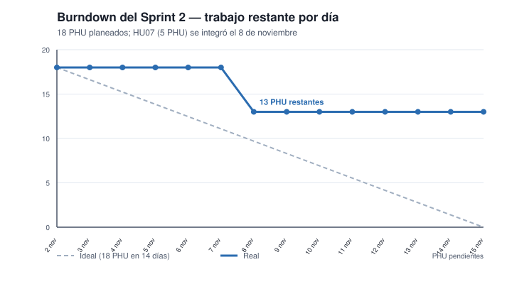
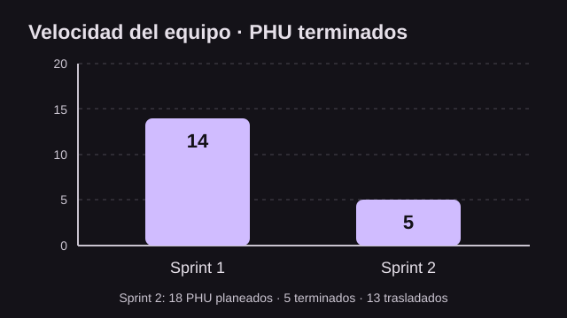

# Retrospectiva documentada del Sprint 2

**Periodo:** 2–15 de noviembre de 2026. **Fuente de datos:** [plan y estado del Sprint 2 en la wiki](https://github.com/jhonospina2711/MISW4201-202615-Vinilos-Mobile-Grupo13/wiki/7.Sprint-2), issues [HU05](https://github.com/jhonospina2711/MISW4201-202615-Vinilos-Mobile-Grupo13/issues/5) a [HU08](https://github.com/jhonospina2711/MISW4201-202615-Vinilos-Mobile-Grupo13/issues/8), y [PR #78](https://github.com/jhonospina2711/MISW4201-202615-Vinilos-Mobile-Grupo13/pull/78). Este texto analiza evidencia del repositorio; el equipo debe revisar y aprobar las conclusiones en su reunión, y agregar fecha, asistentes y acta reales.

## Planeado frente a ejecutado

| Historia | Planeado (PHU) | Terminado al cierre (PHU) | Resultado |
|---|---:|---:|---|
| HU05 · listado de coleccionistas | 3 | 0 | Se trasladó al Sprint 3 |
| HU06 · detalle de coleccionista | 5 | 0 | Se trasladó al Sprint 3 |
| HU07 · crear álbum | 5 | 5 | Integrada mediante PR #78 el 8 de noviembre |
| HU08 · asociar tracks | 5 | 0 | Se trasladó al Sprint 3 |
| **Total** | **18** | **5** | **13 PHU pendientes** |

La velocidad real fue **5 PHU**, frente a 18 comprometidos: diferencia de **−13 PHU** y cumplimiento por puntos de **27,8 %**. La gráfica utiliza el cierre de HU07 del 8 de noviembre; los puntos de una historia se descuentan solo al estar terminada, no por trabajo parcial. El avance puede haber existido en ramas o tareas, pero no equivale a una historia aceptada en `main` al cierre. La velocidad del Sprint 1 fue 14 PHU; esta diferencia no implica por sí sola que el equipo trabajara menos horas, porque los puntos miden historias terminadas y hubo trabajo transversal de rendimiento, pruebas y documentación.

## Lectura del proceso

**Funcionó:** HU07 atravesó formulario, validación, API, actualización visible y pruebas Espresso. El equipo también dejó trabajo de perfilamiento y micro-optimizaciones documentado en el [Sprint 2](DESEMPENO_SPRINT2.md). El release de la iteración permitió demostrar cinco historias acumuladas del MVP.

**Dificultó el compromiso:** tres de cuatro historias planeadas siguieron abiertas al cierre. La wiki de Sprint 2 ya registró el traslado de HU05, HU06 y HU08. Esto muestra que el compromiso de 18 PHU no se ajustó a la capacidad real de completar e integrar historias durante esas dos semanas. Los artefactos transversales consumieron capacidad que los PHU de las historias no reflejaban.

**Acciones para Sprint 3:**

| Acción | Responsable propuesto | Evidencia de cierre |
|---|---|---|
| Integrar HU05, HU06 y HU08 por PR a `develop` y ejecutar sus E2E junto con la regresión | Equipo de implementación y revisión | PR, XML de 32 escenarios Espresso, historias aceptadas |
| Publicar arquitectura y estrategia de pruebas de las ocho historias | Equipo de documentación | Diagramas y enlaces desde la wiki de Sprint 3 |
| Ejecutar Accessibility Scanner, exploración sistemática/aleatoria y perfilamiento en tres físicos | Equipo de calidad | Capturas, bitácoras, métricas e issues de defectos |
| Revisar el burndown durante el sprint y ajustar alcance si queda trabajo sin integrar | Scrum team | Tablero e hitos con fecha; actas reales de semanas 7 y 8 |
| Preparar APK, PR de integración, release en `main` y tag | Equipo de integración | APK instalable, commit y release verificables |

## Coevaluación y aportes

La coevaluación es personal y debe diligenciarla cada integrante. Para fundamentarla, usar el [registro de responsabilidades de la semana 6](https://github.com/jhonospina2711/MISW4201-202615-Vinilos-Mobile-Grupo13/wiki/5.6-Acta-semana-6), PR, commits, pruebas y documentos. La [guía de coevaluación](COEVALUACION_SPRINT2_GUIA.md) separa aportes observables de la valoración que cada estudiante debe hacer. No se consignan aquí puntajes o respuestas atribuidos a compañeros sin que ellos los hayan emitido.

**Pendiente de validación del equipo:** fecha y asistentes de la retrospectiva, decisiones que acuerden, referencia al acta y constancia de coevaluaciones individuales. La gráfica y la comparación de PHU sí se derivan del backlog y los cierres publicados.
